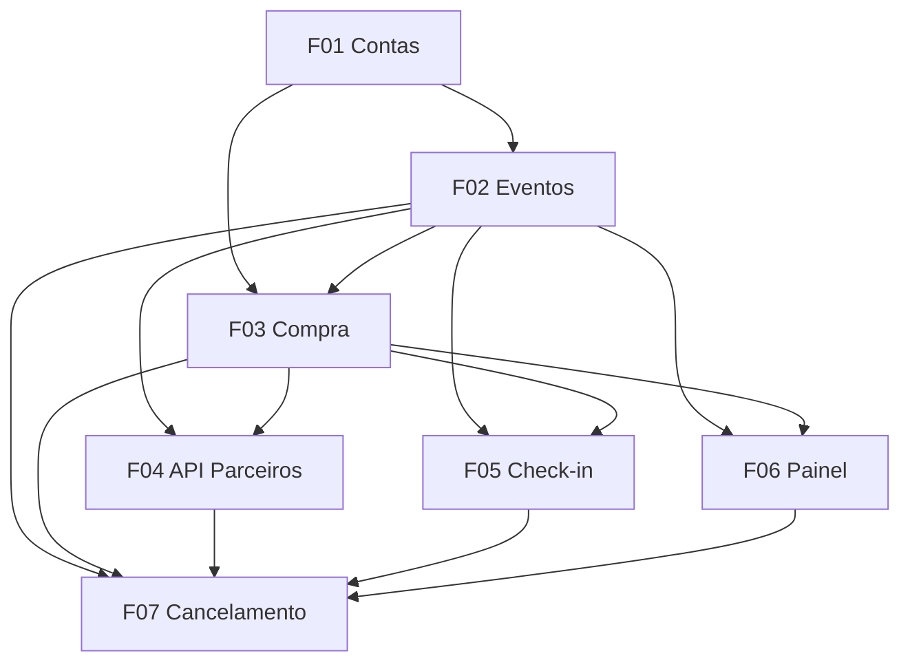

# Catraca — PRD do MVP

*Gerado a partir de [`docs/brief.md`](brief.md) seguindo o formato da skill `prd-writer` (Full Cycle). As regras R01–R13 vêm do brief e são citadas nos critérios da Seção 9.*

## 1. Resumo executivo

A Catraca vende ingressos para eventos pequenos (shows em bar, workshops, meetups). O MVP entrega: contas de participante, área do organizador para criar e operar eventos, vitrine pública com compra de um ingresso por vez via gateway de pagamento (simulado), check-in por código, cancelamento com estorno, painel por evento e uma API de parceiros com contrato fixo. A primeira tentativa falhou na **integração**: cada recurso funcionava sozinho, mas evento cancelado deixava gente entrar, o painel somava estorno como receita e um show de 100 lugares vendeu 112. Este PRD trata os pontos de encontro entre recursos como critérios de aceite de primeira classe (bloco *Cross-Feature Integration*).

## 2. Problema e oportunidade

| Problema (tentativa anterior) | Resposta neste PRD |
|---|---|
| Evento cancelado continuava liberando entrada | F05 checa o status do evento antes do status do ingresso (R10 item 2); critério X13 com F07 |
| Painel somava estorno como receita | F06 soma só `confirmed` com o preço gravado no ingresso; critério X14 com F07 |
| Show de 100 lugares vendeu 112 sob pico | F03 serializa a alocação de vagas por evento no banco (R07); critério de rajada em F04 |
| Cada agente declarava sua parte pronta | contrato por feature + avaliador independente + Fluxo do avaliador na `main` |

## 3. Público-alvo

### Usuários primários
- **Visitante** — sem login, vê a vitrine.
- **Participante** — cria conta (nome, e-mail, senha), entra, sai, compra e vê seus ingressos.
- **Organizador** — conta vinda da seed; cria e opera os próprios eventos.
- **Parceiro** — sistema externo que vende pela API com `X-Api-Key`.

### Perfil comportamental
Eventos pequenos (lotação de 1 a algumas centenas), picos curtos de compra na abertura das vendas, check-in feito na porta pelo organizador digitando o código.

## 4. Objetivos

| Objetivo | Métrica |
|---|---|
| Nunca vender além da lotação | 0 ocorrências em 2+ rodadas de 30 compras simultâneas em lotação 5 (exatamente 5 × 202 e 25 × 409) |
| Resposta de compra sem esperar o gateway | compra responde com `pending` em < 1 s mesmo com cartão de 30–40 s |
| Confirmação rápida | cartão `0001` confirmado em ≤ 5 s |
| Cancelamento consistente | 100% dos ingressos do evento migrados (confirmados→estornados, pendentes→cancelados) em ≤ 10 s |
| Ambiente reprodutível | 1 comando sobe, 1 derruba, 1 roda os gates, a partir de clone limpo |

## 5. Histórias de usuário

### F01. Fundação e Contas
- Como visitante, quero criar uma conta de participante com nome, e-mail e senha para poder comprar.
- Como participante ou organizador, quero entrar e sair.

### F02. Gestão de Eventos
- Como organizador, quero criar um evento em rascunho, editá-lo e publicá-lo, cada um com sua página de gerenciamento.
- Como visitante, quero ver a vitrine com os eventos publicados.

### F03. Compra e Gateway
- Como participante, quero comprar um ingresso na vitrine e acompanhar o status e o código em "Meus ingressos".

### F04. API de Parceiros
- Como parceiro, quero listar eventos à venda, comprar e consultar ingressos por uma API autenticada por chave.

### F05. Check-in
- Como organizador, quero digitar o código de um ingresso na página do evento e saber se a pessoa pode entrar.

### F06. Painel do Evento
- Como organizador, quero ver confirmados, pendentes, check-ins, vagas, receita e estornos do meu evento.

### F07. Cancelamento de Evento
- Como organizador, quero cancelar um evento publicado e ter os ingressos estornados ou cancelados automaticamente.

## 6. Funcionalidades

### F01. Fundação e Contas
Harness do projeto (Docker Compose, scripts de subir/derrubar/gates, migrações, seed), layout HTML, sessão por cookie e contas.

**Fornece (Provides):**
- Sessão autenticada por cookie `catraca_sid` e o usuário corrente (`id`, `name`, `email`, `role` ∈ {`participant`, `organizer`}).
- Guardas de acesso `requireParticipant` e `requireOrganizer` (visitante → login; papel errado → 403).
- Contas da seed: organizador A, organizador B e participante (idempotente).
- Layout HTML compartilhado, pool de banco, executor de migrações, harness (`up`, `down`, `gates`).

**Consome (Consumes):** nada.

### F02. Gestão de Eventos
CRUD de eventos do organizador, publicação, vitrine e página pública do evento.

**Fornece:**
- Entidade Evento: `id` (`evt_…`), `organizerId`, `name`, `startsAt`, `venue`, `capacity`, `priceCents`, `status` ∈ {`draft`, `published`, `cancelled`}.
- Consulta `listEventsOnSale()` (publicados e não cancelados) e `findOwnedEvent(organizerId, eventId)`.
- Página de gerenciamento `/organizador/eventos/:id` (URL própria, R04) com ponto de extensão de seções (check-in, painel, cancelamento).
- Página pública `/eventos/:id` com ponto de extensão de seções (compra).
- Ponto de extensão `capacityGuards` chamado na edição, dentro da transação que trava o evento.

**Consome:** F01 — sessão de organizador e guarda `requireOrganizer`.

### F03. Compra e Gateway
Alocação de vaga, criação do ingresso, gateway simulado assíncrono e "Meus ingressos".

**Fornece:**
- Serviço `purchaseTicket({eventId, cardNumber, channel, userId?, buyerEmail})` → ingresso `pending`, com erros `InvalidCard`, `EventNotAvailable`, `SoldOut`; garante R07 sob concorrência.
- Consulta de vagas `seatsFor(eventId)` → `{capacity, occupied, available}` (R05).
- Modelo de Ingresso: `id` (`tkt_…`), `code` (8 caracteres, único), `status`, `priceCents` gravado na compra, `channel`, `checkedInAt`.
- Processador de pagamentos assíncrono que aplica a resposta do gateway só a ingressos ainda `pending`.
- Guarda de lotação registrada em `capacityGuards` (R03).
- Página "Meus ingressos".

**Consome:** F01 — participante logado; F02 — evento publicado, lotação, preço vigente, página pública, `capacityGuards`.

### F04. API de Parceiros
As três rotas do contrato fixo, autenticadas por `X-Api-Key`.

**Fornece:** `GET /api/partner/events`, `POST /api/partner/events/{eventId}/purchases`, `GET /api/partner/tickets/{ticketId}`.

**Consome:** F02 — `listEventsOnSale()`; F03 — `purchaseTicket` (canal `partner`), `seatsFor`, consulta de ingresso por id.

### F05. Check-in
Formulário de check-in na página de gerenciamento.

**Fornece:** seção de check-in e a ação `POST /organizador/eventos/:id/checkin`, que aplica a lista ordenada do R10 e marca `checkedInAt`.

**Consome:** F02 — página de gerenciamento, posse do evento e status `cancelled`; F03 — ingresso por código (status e `checkedInAt`).

### F06. Painel do Evento
Seção de painel na página de gerenciamento.

**Fornece:** painel com Confirmados, Pendentes, Check-ins, Vagas disponíveis, Receita e Estornados (R12).

**Consome:** F02 — página de gerenciamento e posse; F03 — ingressos (status, `priceCents`, `checkedInAt`) e `seatsFor`.

### F07. Cancelamento de Evento
Ação de cancelar na página de gerenciamento.

**Fornece:** `POST /organizador/eventos/:id/cancelar` — cancelamento irreversível com migração atômica de ingressos.

**Consome:** F02 — status do evento, bloqueio de edição/republicação, página de gerenciamento; F03 — ingressos e o processador de pagamentos (resposta tardia não altera); F04 — listagem e compra pela API (efeito do cancelamento observado nela); F05 — mensagem `Evento cancelado` no check-in; F06 — contagem de Estornados e Vagas 0 no painel.

## 7. Fora de escopo

- Deploy e qualquer ambiente além do local.
- Gateway de pagamento real, e-mail e notificações.
- App mobile e qualidade visual (nenhum critério de design).
- Cadastro de organizador pelo produto (organizadores só vêm da seed).
- Mais de um ingresso por compra, mapa de assentos, cancelamento ou transferência de ingresso pelo participante.
- Atualização em tempo real: recarregar a página basta.
- Fuso horário: o produto usa o horário de Brasília (`-03:00`) para entrada e saída de datas.
- Recuperação de senha, edição de perfil, paginação, busca.
- Estorno real em dinheiro (o estorno é uma mudança de status).

## 8. Grafo de dependências

### Parte 1: Tabela de dependências

| # | Feature | Prioridade | Dependências |
|---|---------|-----------|--------------|
| 1 | F01 Fundação e Contas | 1 | None |
| 2 | F02 Gestão de Eventos | 1 | F01 |
| 3 | F03 Compra e Gateway | 1 | F01, F02 |
| 4 | F04 API de Parceiros | 1 | F02, F03 |
| 5 | F05 Check-in | 1 | F02, F03 |
| 6 | F06 Painel do Evento | 1 | F02, F03 |
| 7 | F07 Cancelamento de Evento | 1 | F02, F03, F04, F05, F06 |

### Parte 2: Features de fundação
Estas features montam infraestrutura compartilhada e são implementadas em sequência:
- **F01 Fundação e Contas** — Compose, scripts, migrações, seed, sessão, layout e guardas.
- **F02 Gestão de Eventos** — modelo de evento e os pontos de extensão das páginas de gerenciamento e pública.

### Parte 3: Ondas de execução
Features da mesma onda podem ser construídas em paralelo. Uma onda começa só depois que todas as features das ondas anteriores estão concluídas.

**Nota:** features de fundação não rodam em paralelo entre si.

- **Onda 1**: F01
- **Onda 2**: F02
- **Onda 3**: F03
- **Onda 4**: F04, F05, F06 ← **onda paralela** (worktrees + PRs)
- **Onda 5**: F07

### Parte 4: Prioridades
- **1** = Essencial — o produto não funciona sem ela
- **2** = Importante — agrega valor significativo
- **3** = Desejável — melhoria incremental

### Parte 5: Diagrama

## 9. Critérios de aceite

Cada critério tem um ID estável. Os contratos mapeiam o **texto** e o ID de cada critério para itens verificáveis.

### F01. Fundação e Contas
- **AC-F01-01** Um visitante cria uma conta de participante informando nome, e-mail e senha e fica logado como participante.
- **AC-F01-02** O cadastro é rejeitado, com mensagem e sem criar conta, quando o nome está vazio, o e-mail é mal formado ou já existe, ou a senha tem menos de 6 caracteres.
- **AC-F01-03** As contas da seed (organizador A, organizador B, participante) entram com as credenciais do README; e-mail ou senha errados são rejeitados.
- **AC-F01-04** Sair encerra a sessão: depois de sair, páginas que exigem login voltam a pedir login.
- **AC-F01-05** O cadastro nunca cria organizador: toda conta criada pelo produto tem papel participante (organizadores só vêm da seed).
- **AC-F01-06** Visitante que acessa a área do organizador é levado ao login, e participante recebe acesso negado (403) sem dados de eventos (R13).
- **AC-F01-07** Em um clone limpo, o comando de subida deixa o produto acessível em `$WEB` com a seed aplicada; derrubar e subir de novo funciona sem erro e a seed continua válida.
- **AC-F01-08** O comando de derrubar encerra todos os contêineres e portas abertos pela subida, e o comando de gates roda os testes automatizados e termina com sucesso.

### F02. Gestão de Eventos
- **AC-F02-01** O organizador cria um evento com nome, data e hora de início, local, lotação inteira ≥ 1 e preço em reais > 0, e o evento nasce como rascunho (R01, R02).
- **AC-F02-02** A criação é rejeitada quando a lotação é menor que 1, o preço não é maior que zero, falta algum campo ou a data de início não está no futuro — inclusive a data de ontem (R01).
- **AC-F02-03** Editar com data de início no passado é rejeitado; uma edição válida (nome, data, local, preço, lotação maior) é aceita (R01, R03).
- **AC-F02-04** Evento em rascunho não aparece na vitrine nem tem página pública; ao publicar, aparece na vitrine (R02).
- **AC-F02-05** Cada evento tem uma página de gerenciamento com URL própria, acessível pela lista "Meus eventos", onde o organizador edita e publica (R04).
- **AC-F02-06** Na área do organizador, a lista mostra só os eventos do organizador logado, e abrir a página de gerenciamento de um evento de outro organizador não exibe nenhum dado dele (R13).
- **AC-F02-07** Um evento cancelado não pode ser editado nem republicado (R11).

### F03. Compra e Gateway
- **AC-F03-01** O participante logado compra um ingresso na página pública do evento; a compra nasce pendente, já ocupa vaga e é respondida sem esperar o gateway (R05, R06).
- **AC-F03-02** Com o cartão final `0001`, o ingresso fica confirmado em até 5 segundos (R08).
- **AC-F03-03** Com cartões final `0002`, `0004` ou outro final, o ingresso fica recusado e a vaga é liberada (R05, R08).
- **AC-F03-04** Os finais `0003` e `0004` só respondem entre 30 e 40 segundos, e até lá o ingresso fica pendente ocupando vaga (R05, R06).
- **AC-F03-05** Número de cartão que não tem exatamente 16 dígitos é rejeitado antes de criar o ingresso.
- **AC-F03-06** Sem vaga disponível, a página do evento exibe `Ingressos esgotados` no lugar da compra, e uma tentativa de compra é recusada com `Ingressos esgotados` (R07).
- **AC-F03-07** Com compras simultâneas, as vagas ocupadas nunca passam da lotação (R07).
- **AC-F03-08** Em "Meus ingressos", o participante vê o evento, o status (rótulo) e o código único de 8 caracteres de cada ingresso que comprou, e só os seus (R09).
- **AC-F03-09** Reduzir a lotação para menos que as vagas ocupadas é rejeitado (R03).
- **AC-F03-10** Cada ingresso guarda o preço vigente no momento da compra; mudar o preço não altera ingressos já comprados (R03).
- **AC-F03-11** Visitante não compra: a página pública pede login; só participante compra.

### F04. API de Parceiros
- **AC-F04-01** Nas três rotas, sem `X-Api-Key` ou com chave inválida, a resposta é `401` com `{"error":"unauthorized"}`.
- **AC-F04-02** `GET /api/partner/events` responde `200` com a lista de eventos publicados e não cancelados, cada um com `id`, `name`, `startsAt` (ISO 8601 com fuso), `priceCents` e `availableSeats` (R02, R05).
- **AC-F04-03** `POST /api/partner/events/{eventId}/purchases` válido responde `202` com `ticketId`, `code` e `status` `pending`, sem esperar o gateway (R06).
- **AC-F04-04** Erros da compra seguem a ordem: corpo inválido (campo faltando, e-mail mal formado, cartão sem 16 dígitos) → `422 invalid_request`; evento inexistente, rascunho ou cancelado → `404 event_not_available`; sem vaga → `409 sold_out` (R07).
- **AC-F04-05** `GET /api/partner/tickets/{ticketId}` responde `200` com `ticketId`, `code`, `eventId`, `status` e `checkedIn` para ingresso de qualquer canal; inexistente → `404 ticket_not_found` (R09).
- **AC-F04-06** Em duas rodadas, cada uma num evento novo com lotação 5, 30 compras simultâneas pela API resultam em exatamente 5 respostas `202` e 25 `409` (R07).

### F05. Check-in
- **AC-F05-01** Código inexistente ou de ingresso de outro evento exibe `Ingresso inválido para este evento` (R10.1).
- **AC-F05-02** Código válido de evento cancelado exibe `Evento cancelado` (R10.2).
- **AC-F05-03** Ingresso pendente, recusado, cancelado ou estornado exibe `Ingresso não confirmado` (R10.3).
- **AC-F05-04** Ingresso confirmado que já passou pelo check-in exibe `Ingresso já utilizado` (R10.4).
- **AC-F05-05** Ingresso confirmado sem check-in exibe `Entrada liberada` e passa a constar como check-in feito (R10.5).
- **AC-F05-06** Só o organizador dono do evento faz check-in nele; outro organizador não consegue (R04, R13).

### F06. Painel do Evento
- **AC-F06-01** O painel na página de gerenciamento mostra Confirmados (inclui os com check-in), Pendentes e Estornados com a contagem exata de ingressos em cada status (R12).
- **AC-F06-02** Check-ins conta só ingressos confirmados que passaram pelo check-in (R12).
- **AC-F06-03** Vagas disponíveis segue R05: lotação − (pendentes + confirmados), e 0 em evento cancelado (R05, R12).
- **AC-F06-04** Receita é a soma do preço pago por ingresso confirmado, usando o preço vigente em cada compra, exibida em reais (`R$ 350,00`) (R03, R12).
- **AC-F06-05** O painel conta igualmente vendas da vitrine e da API (R12).

### F07. Cancelamento de Evento
- **AC-F07-01** O organizador dono cancela um evento publicado pela página de gerenciamento; rascunho ou evento de outro organizador não pode ser cancelado (R11, R13).
- **AC-F07-02** O cancelamento é irreversível: o evento cancelado não pode ser republicado, editado nem cancelado de novo (R11).
- **AC-F07-03** Evento cancelado sai da vitrine e não vende mais (R02, R11).
- **AC-F07-04** Em até 10 segundos do cancelamento, os ingressos confirmados ficam estornados e os pendentes ficam cancelados (R11).
- **AC-F07-05** Resposta do gateway que chega depois do cancelamento não muda o status de nenhum ingresso (R11).

### Cross-Feature Integration
Um ou mais critérios por aresta do grafo (Seção 8). O contrato dono de cada critério está indicado entre colchetes.

- **X01 (F01→F02)** O organizador A, logado pela sessão de F01, cria eventos que ficam atribuídos a ele e aparecem só na sua lista; o participante logado pela sessão de F01 recebe 403 na área do organizador (R13). [contrato F02]
- **X02 (F01→F03)** Um participante criado pelo cadastro da UI (F01) compra na vitrine e vê o ingresso em "Meus ingressos"; outro participante não vê esse ingresso (R09). [contrato F03]
- **X03 (F02→F03)** Só evento publicado em F02 aceita compra (rascunho responde como indisponível); a edição de preço em F02 vale só para compras posteriores; a redução de lotação em F02 abaixo das vagas ocupadas de F03 é rejeitada e o aumento é aceito (R02, R03). [contrato F03]
- **X04 (F02→F04)** O evento publicado em F02 aparece em `GET /api/partner/events` com `priceCents` = preço × 100 e `startsAt` igual à data cadastrada; rascunho não aparece e comprá-lo pela API responde `404 event_not_available` (R02). [contrato F04]
- **X05 (F03→F04)** Compra pela API passa pelo mesmo serviço de F03: ocupa vaga (`availableSeats` diminui), é confirmada/recusada pelo mesmo gateway, e um ingresso comprado na vitrine é consultável em `GET /api/partner/tickets/{id}` (R05, R06, R08). [contrato F04]
- **X06 (F02→F05)** O check-in roda na página de gerenciamento de F02 do evento dono; um ingresso válido de outro evento (inclusive de outro organizador) resulta em `Ingresso inválido para este evento` (R10, R13). [contrato F05]
- **X07 (F03→F05)** Ingresso confirmado pelo gateway de F03 (vitrine ou API) resulta em `Entrada liberada`; ingresso pendente ou recusado por F03 resulta em `Ingresso não confirmado`; o check-in aparece como `checkedIn: true` na API de F04 quando F04 está presente (R08, R10). [contrato F05]
- **X08 (F02→F06)** O painel aparece na página de gerenciamento de F02 e só para o organizador dono (R04, R13). [contrato F06]
- **X09 (F03→F06)** Os números do painel batem com os ingressos criados por F03 em vitrine e API, inclusive Receita com o preço de cada compra após mudança de preço e Check-ins após check-in (R03, R05, R12). [contrato F06]
- **X10 (F02→F07)** Depois do cancelamento, a página de gerenciamento de F02 não oferece edição nem publicação e recusa a edição enviada diretamente; o evento some da vitrine e da página pública de F02 (R11). [contrato F07]
- **X11 (F03→F07)** O cancelamento migra os ingressos de F03 (confirmados→estornados, pendentes→cancelados) em ≤ 10 s; uma resposta tardia do gateway de F03 (cartão `0003`) não altera o ingresso cancelado; compra pela vitrine é recusada (R05, R11). [contrato F07]
- **X12 (F04→F07)** Evento cancelado some de `GET /api/partner/events`; a compra pela API responde `404 event_not_available`; `GET /api/partner/tickets/{id}` mostra `refunded` e `cancelled` (R11). [contrato F07]
- **X13 (F05→F07)** Check-in de um ingresso de evento cancelado resulta em `Evento cancelado`, inclusive para ingresso que estava confirmado (R10, R11). [contrato F07]
- **X14 (F06→F07)** Depois do cancelamento, o painel mostra Confirmados 0, Pendentes 0, Vagas disponíveis 0, Receita R$ 0,00 e Estornados igual aos confirmados de antes (R11, R12). [contrato F07]

### Rastreabilidade das regras

| Regra | Critérios |
|---|---|
| R01 | AC-F02-01, AC-F02-02, AC-F02-03 |
| R02 | AC-F02-01, AC-F02-04, AC-F04-02, AC-F07-03, X03, X04 |
| R03 | AC-F02-03, AC-F03-09, AC-F03-10, AC-F06-04, X03, X09 |
| R04 | AC-F02-05, AC-F05-06, X08 |
| R05 | AC-F03-01, AC-F03-03, AC-F03-04, AC-F04-02, AC-F06-03, X05, X09, X11 |
| R06 | AC-F03-01, AC-F03-04, AC-F04-03, X05 |
| R07 | AC-F03-06, AC-F03-07, AC-F04-04, AC-F04-06 |
| R08 | AC-F03-02, AC-F03-03, X05, X07 |
| R09 | AC-F03-08, AC-F04-05, X02 |
| R10 | AC-F05-01 … AC-F05-05, X06, X07, X13 |
| R11 | AC-F02-07, AC-F07-01 … AC-F07-05, X10, X11, X12, X13, X14 |
| R12 | AC-F06-01 … AC-F06-05, X09, X14 |
| R13 | AC-F01-06, AC-F02-06, AC-F05-06, AC-F07-01, X01, X06, X08 |
